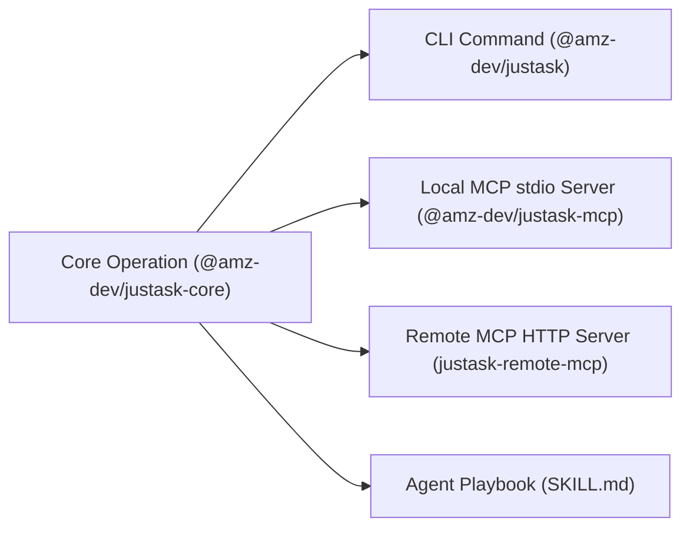

<p align="center">
  
</p>

<h1 align="center">JustAsk</h1>

<p align="center">
  Build agent-ready tools with one shared TypeScript core for MCP, CLI, and Skills.
</p>

<p align="center">
  by <a href="https://github.com/affan-DevOp">Affan Mushtaque (@affan-DevOp)</a>
</p>

<p align="center">
  <a href="./LICENSE"></a>
  <a href="https://www.npmjs.com/package/@amz-dev/justask"></a>
  <a href="https://www.npmjs.com/package/@amz-dev/justask-mcp"></a>
  <a href="https://clerk.com"></a>
  <a href="https://modelcontextprotocol.io"></a>
  <a href="https://github.com/affan-DevOp/JustAsk-MCP"></a>
</p>

> **Prompt:** "Send a Telegram message to my team saying the deployment succeeded."
>
> **Agent:** Uses JustAsk's `telegram` MCP tool with `{ "chatId": "...", "message": "The deployment succeeded." }`, backed by the same pure core operation available from the CLI and Agent Skill.

---

## Quick Start

```bash
# Run directly with npx or bunx without installing:
npx @amz-dev/justask init --telegram-bot-token "<bot-token>"
npx @amz-dev/justask telegram "<chat-id>" "Hello from JustAsk"
```

Or install globally:

```bash
npm install -g @amz-dev/justask
justask init --telegram-bot-token "<bot-token>"
justask telegram "<chat-id>" "Hello from JustAsk"
```

---

<details>
<summary><strong>Table of contents</strong></summary>

- [Overview & Architecture](#overview--architecture)
- [Monorepo Structure](#monorepo-structure)
- [Prerequisites](#prerequisites)
- [CLI Usage](#cli-usage)
- [Local MCP Server (stdio)](#local-mcp-server-stdio)
- [Remote MCP Server (HTTP + Clerk OAuth 2.1)](#remote-mcp-server-http--clerk-oauth-21)
- [Agent Skill (SKILL.md)](#agent-skill-skillmd)
- [Local Development & Building](#local-development--building)
- [Publishing to NPM](#publishing-to-npm)
- [Troubleshooting](#troubleshooting)

</details>

---

## Overview & Architecture

JustAsk is an agent tooling monorepo demonstrating how one single business operation (`sendTelegramMessage`) powers a complete agent ecosystem:



Business logic lives strictly in `packages/core`. Every other package is an adapter, ensuring that human users, terminal scripts, local AI clients, and remote cloud agents all execute the exact same verified implementation without code drift.

---

## Monorepo Structure

| Package | Scoped NPM Name | Role |
| :--- | :--- | :--- |
| `packages/core` | `@amz-dev/justask-core` | Shared Zod schemas, validation, and Telegram Bot API operations. |
| `packages/cli` | `@amz-dev/justask` | Developer and scripting CLI adapter (`justask` binary). |
| `packages/local-mcp` | `@amz-dev/justask-mcp` | Standard `stdio` JSON-RPC MCP server adapter for OpenCode, Cursor, and Claude Desktop. |
| `apps/remote-mcp` | `justask-remote-mcp` | Streamable HTTP MCP server powered by Hono with Clerk OAuth 2.1 & RFC-9723 resource metadata. |
| `skills/justask` | — | Playbook instructions for agents deciding between MCP and CLI workflows. |

---

## Prerequisites

- A Telegram Bot Token from [@BotFather](https://t.me/BotFather).
- Your target Telegram Chat ID (can be obtained via [@userinfobot](https://t.me/userinfobot) or your bot's `/getUpdates`).
- [Bun](https://bun.sh) (`v1.2+`) for local monorepo development.
- Node.js (`v20+`) for running published packages.

---

## CLI Usage

### 1. Initialize Configuration
Save your Telegram bot token securely to `~/.config/justask/config.json` with restricted `0600` file permissions:

```bash
justask init --telegram-bot-token "<your-bot-token>"
```

### 2. Send Telegram Messages
```bash
justask telegram "<chat-id>" "Your message here"
```

The CLI prints a structured JSON response:
```json
{
  "ok": true,
  "chatId": "123456789",
  "messageId": 42
}
```

---

## Local MCP Server (stdio)

Run the local MCP server inside any MCP-compatible client.

### OpenCode Configuration (`opencode.json`)
```json
{
  "mcp": {
    "servers": {
      "justask": {
        "command": "bun",
        "args": ["run", "packages/local-mcp/src/index.ts"],
        "env": {
          "TELEGRAM_BOT_TOKEN": "your_bot_token_here"
        }
      }
    }
  }
}
```

### Claude Desktop / Cursor Configuration
```json
{
  "mcpServers": {
    "justask": {
      "command": "npx",
      "args": ["-y", "@amz-dev/justask-mcp"],
      "env": {
        "TELEGRAM_BOT_TOKEN": "your_bot_token_here"
      }
    }
  }
}
```

The local server exposes the `telegram` tool with `{ chatId, message }`. The bot token is read from the server environment, keeping credentials out of the prompt context.

---

## Remote MCP Server (HTTP + Clerk OAuth 2.1)

The remote server (`apps/remote-mcp`) provides an authenticated HTTP endpoint using Hono and Web Standard Streamable HTTP transport.

### Features
- **Dynamic URL routing**: `POST /:botToken/mcp`
- **RFC-9723 Protected Resource Metadata**: `GET /.well-known/oauth-protected-resource/:botToken/mcp`
- **OAuth 2.1 Challenge**: Automatically challenges unauthenticated requests with `WWW-Authenticate: Bearer ...` pointing to your Clerk authorization server.
- **Dynamic Client Registration (DCR)**: Compatible with modern AI clients supporting automatic client onboarding.

### Environment Setup (`.env`)
```env
PORT=3000
CLERK_PUBLISHABLE_KEY=pk_test_...
CLERK_SECRET_KEY=sk_test_...
```

Run locally:
```bash
bun run dev:remote-mcp
```

---

## Agent Skill (SKILL.md)

Located at [`skills/justask/SKILL.md`](./skills/justask/SKILL.md), this playbook informs autonomous agents how to use JustAsk:
- **Preferred Path**: Call the `telegram` tool on the connected MCP server.
- **Fallback Path**: Execute `justask telegram <chatId> <message>` if the MCP server is not active.

---

## Local Development & Building

Install dependencies:
```bash
bun install
```

Build all packages using `tsdown`:
```bash
bun run build
```

Run TypeScript type check:
```bash
bun run typecheck
```

Test dry-run packaging:
```bash
bun run release:pack:core
bun run release:pack:cli
bun run release:pack:local-mcp
```

---

## Publishing to NPM

Packages can be published under the `@amz-dev` scope:

```bash
# 1. Login to npm
npm login

# 2. Publish shared core first
cd packages/core
bun publish

# 3. Publish CLI and Local MCP
cd ../cli
bun publish

cd ../local-mcp
bun publish
```

---

## Troubleshooting

- **`Telegram bot token is required`**: Run `justask init --telegram-bot-token <token>` or supply `TELEGRAM_BOT_TOKEN` in your environment.
- **Local MCP hanging**: Expected behavior when started directly in a terminal without an MCP client; the server is listening for JSON-RPC messages over standard input.
- **401 Unauthorized on Remote MCP**: Ensure your client supplies a valid Bearer token from Clerk with the required scopes.

---

## License

MIT © [Affan Mushtaque](https://github.com/affan-DevOp)
